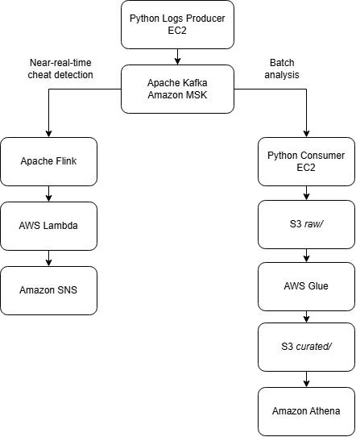
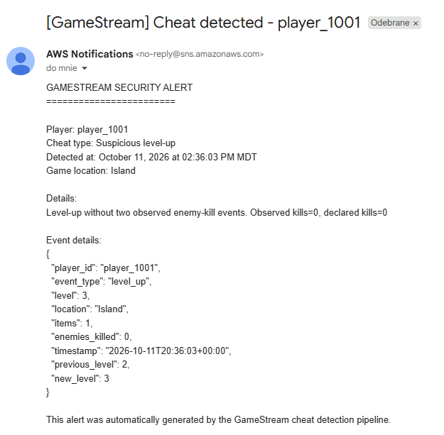
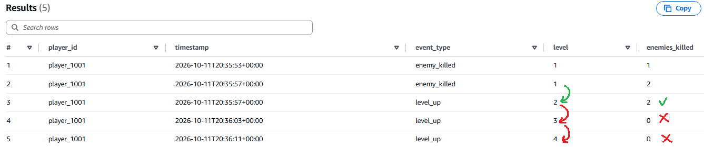
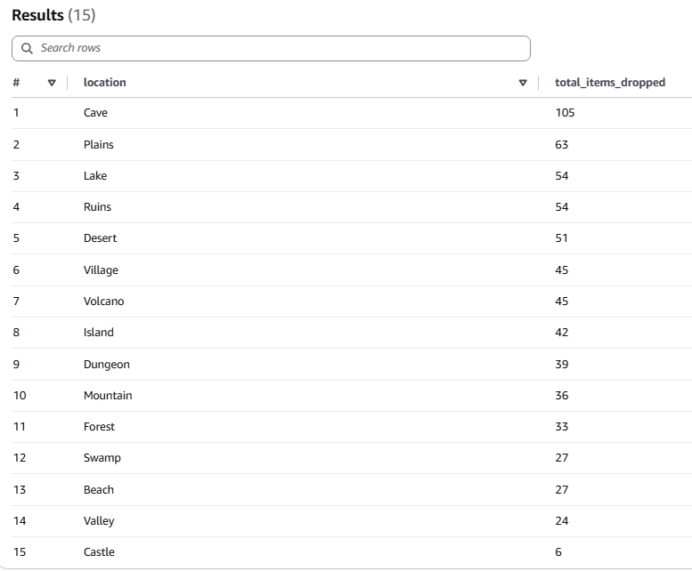
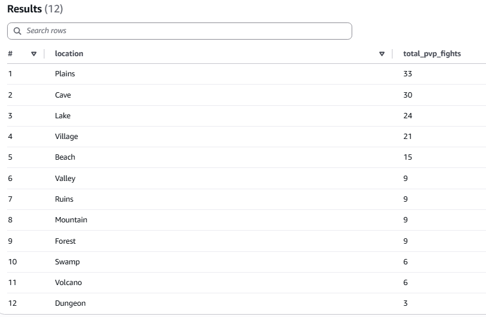

# GameStream — Game Event Streaming & Cheat Detection

**Apache Kafka | Flink | Amazon MSK | Amazon EC2 | Amazon S3 | AWS Glue | AWS Lambda | Athena | Amazon SNS**

A streaming data pipeline for near-real-time cheat detection and gameplay analytics, built around a simulated RPG game.

# Business Problem

A gaming company continuously streams gameplay logs and needs to **detect suspicious player behavior in near real time**, automatically notifying its team when potential cheating is detected. It also needs to **store raw logs** cost-effectively, optimize them for analytical queries, and support **historical analysis** using SQL.

# My approach

To simulate and address this problem, I decided to split the pipeline into two separate flows: one for near-real-time cheat detection and another for batch processing and historical analytics.

<p align="center">
  
</p>

As shown in the diagram, several AWS services were used:

- For streaming game logs, I used an **Amazon EC2** instance to host the producer. It runs a producer.py script that generates gameplay events based on the rules described in the Gameplay section below.
- For the streaming platform, **Apache Kafka** was chosen and implemented using Amazon MSK. Kafka stores events from the producer in the *game-events* topic. Kinesis Data Streams was also an option, but Kafka was chosen because it is more versatile (and because it appears more frequently in job postings).
- For near-real-time cheat detection, **Apache Flink** was chosen because it supports stateful stream processing, which is useful for tracking enemy kills and collected items across multiple events.
- After a cheat is detected, **AWS Lambda** is triggered to send an email notification through **Amazon SNS**.
- The same **EC2** instance was used again to run the consumer, using the consumer.py script. It reads events from the Kafka topic and saves them to S3 in batches.
- **Amazon S3** was an obvious choice for storage due to its cost-effectiveness and ease of configuration. Files are stored in the raw/ prefix, partitioned by year, month, and day. A lifecycle rule moves raw files to S3 Glacier Flexible Retrieval after 30 days to reduce storage costs.
- I used **AWS Glue Jobs** to prepare the ETL process. The job converts JSONL files to Parquet, a columnar format that allows Athena to query data more efficiently. It also validates the data and moves incomplete or invalid records to a dedicated quarantine folder. Valid data is written to the curated/ prefix, partitioned by year, month, and day. Incremental processing was implemented and the job is scheduled to run every hour. An **AWS Glue Crawler** was also configured to discover the data schema and update the Data Catalog.
- **Amazon Athena** was used to query the data with SQL, enabling historical gameplay analysis.

# Gameplay

The gameplay is inspired by Metin2.

Five players interact across 15 locations. Each player can:
- **Travel:** Move to another location (25% chance per turn).
- **Fight enemies:** Kill mobs and gain one level after every two kills (75% chance when staying).
- **Collect items:** Search the current location for items (25% chance when staying).
- **Fight other players:** When two players meet at the same location, they may engage in PvP. The outcome depends on their levels, items, and luck. The loser normally loses one level.

For entertainment purposes and to keep our anti-cheat system busy, a few players occasionally bend the rules:
- **Illegal level-up:** 2% chance of gaining a level without killing two mobs.
- **Level protection cheat:** 10% chance of keeping a level after losing a PvP fight.
- **Double item drop:** 5% chance of receiving two items from a single loot roll.

# Results

After configuring Flink to read from Kafka and send detection results to Lambda (and spending more time than expected on security groups and VPC endpoints), the first alerts started arriving in my Gmail inbox.

<p align="center">
  
</p>

But did Flink correctly accuse this player of cheating? We can easily verify this in Athena using below query.

```sql
SELECT
    player_id,
    timestamp,
    event_type,
    level,
    enemies_killed
FROM gamestream_db.curated
WHERE player_id = 'player_1001'
  AND event_timestamp >= TIMESTAMP '2026-10-11 20:35:30'
  AND event_timestamp < TIMESTAMP '2026-10-11 20:36:30'
  AND event_type IN ('enemy_killed', 'level_up')
ORDER BY event_timestamp;
```

As a reminder, a player must kill two enemies to advance to the next level. The results confirm that player_1001 advanced from level 2 to 3 and then from level 3 to 4 without killing any enemies. This confirms that the player was cheating and deserves a ban.

<p align="center">
  
</p>

Of course, Athena can be used for much more than just finding cheaters. For example, let's say the company wants to analyze item drop rates across different locations as of specific date. 

The query results suggest that Castle is rather poor when it comes to item drops, while Cave seems to be overflowing with loot — which is quite ironic, if you ask me.

<p align="center">
  
</p>

What was the most violent location? Where did players fight the most?

As we can see, the Plains were covered in blood the most. This might be because there's nowhere to hide, making it easy for bow users to pick off their opponents. On the other hand, Castle, Desert, and Island remained peaceful, with no PvP fights at all. Maybe it's just hard to fight in the sand? 🏖️

<p align="center">
  
</p>

To sum up, the project was a success, and I'm really happy with how it turned out. The entire architecture worked as intended, from streaming game events and detecting cheats in near real time to storing data and querying it in Athena. The project also leaves plenty of room for further analysis and experimentation.
